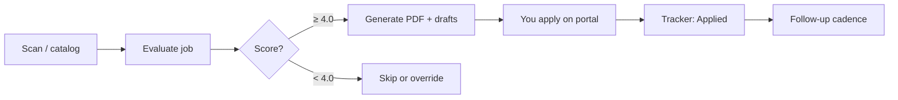

# Application process — Rustam Gurbanov + career-ops

**Important:** career-ops **never clicks Submit/Send/Apply** for you. You review everything and submit yourself.

---

## End-to-end flow

---

## Step 1 — Find roles

| Action | How |
|--------|-----|
| Browse catalog | `data/job-catalog.md` (categories A–H) |
| Scan APIs | `node scan.mjs` → global tech companies |
| AT boards | karriere.at, jobs.at, StepStone, AMS (manual) |

Pick a role from the catalog or paste any job URL in chat.

---

## Step 2 — Evaluate (auto-pipeline)

**You say:** paste URL or *“evaluate Neuronize”*

**career-ops does:**

1. **Fetch JD** — Playwright opens the posting (karriere.at, jobs.at, Greenhouse, etc.)
2. **Score A–G** — fit vs your `cv.md`, `config/profile.yml`, `modes/_profile.md`
3. **Report** — saved to `reports/001-company-date.md`
4. **PDF** — tailored CV → `output/` (from `cv.md` + template)
5. **Tracker line** — TSV in `batch/tracker-additions/` → run `node merge-tracker.mjs`
6. **Draft answers** (if score **≥ 4.5**) — Section H in report for form questions

**Score guide:**

| Score | Recommendation |
|-------|----------------|
| **≥ 4.5** | Strong apply — prioritize |
| **4.0 – 4.4** | Good apply if you want the location/company |
| **< 4.0** | Usually skip (unless you override) |

---

## Step 3 — Prepare documents (Austria / DACH)

Typical **Bewerbungsmappe:**

| Document | career-ops source |
|----------|-------------------|
| **Lebenslauf / CV** | PDF from `/career-ops pdf` or `node generate-pdf.mjs` |
| **Anschreiben** (cover letter) | Ask in chat after evaluation — German for DE ads |
| **Zeugnisse** | Your PDFs in `Rustam_Gurbanov/` — attach manually |
| **Portfolio / GitHub** | Links from profile already in CV |

**Email applications** (Softwaregutachten, efinio, some startups):

- Attach PDF CV + short Anschreiben in email body
- Send to address in posting — **you** hit send

**Portal applications** (karriere.at, jobs.at, company ATS):

- Upload PDF CV
- Fill fields — use **apply mode** (below)
- Often: Gehaltsvorstellung → **€2.500–3.000 net** or ask gross equivalent
- Arbeitserlaubnis → student/master’s in AT, previously employed Infineon

---

## Step 4 — Fill the form (apply mode)

**You say:** *“help me apply to [company]”* or */career-ops apply*

**With browser open on the form:**

1. Agent reads questions (Playwright snapshot or your screenshot)
2. Generates **copy-paste answers** from report + CV
3. Language = **language of the job ad** (German for karriere.at)
4. You paste into fields and **review**
5. **You click Submit**

Repeat for multi-page forms (scroll → next screenshot).

---

## Step 5 — After you submit

Tell the agent: *“I applied to Neuronize”*

- Status in `data/applications.md` → **Applied**
- Optional: LinkedIn outreach (`/career-ops contacto`)
- Follow-ups: `/career-ops followup` — when to nudge recruiter

---

## By application channel

| Channel | Examples | Process |
|---------|----------|---------|
| **karriere.at / jobs.at** | Neuronize, Anexia, ACP | Click “Jetzt bewerben” → upload CV → form → **you submit** |
| **StepStone** | ALTEN | Often redirects to employer ATS |
| **Company career page** | efinio, Softwaregutachten | Email or own form |
| **Greenhouse/Ashby** | n8n, Parloa | English form, EU remote |
| **AMS eJob-Room** | Public sector / some SMEs | Register → apply via portal link |

---

## Your recommended first batch

1. **Neuronize** — evaluate → PDF → German Anschreiben → karriere.at apply  
2. **ACP** — Klagenfurt option  
3. **PMS** — Villach local  
4. **UNiQUARE** — QA/AI lead (thesis story)  
5. **n8n** — if EU remote score is high  

---

## Commands cheat sheet

| Goal | Say / run |
|------|-----------|
| Evaluate one job | Paste URL or *“evaluate [company]”* |
| Generate CV PDF only | *“/career-ops pdf”* or `node generate-pdf.mjs` |
| Apply help | *“/career-ops apply”* + form open |
| Scan new jobs | `node scan.mjs` |
| See tracker | *“/career-ops tracker”* |
| Merge new applications | `node merge-tracker.mjs` |
